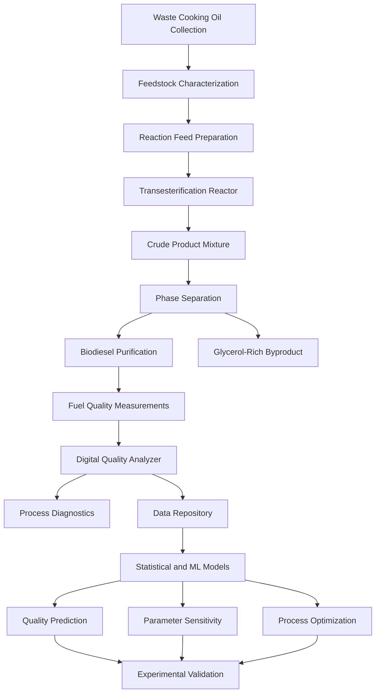

# INTEGRATED PROCESS DEVELOPMENT, SIMULATION AND DIGITAL QUALITY ANALYSIS OF BIODIESEL PRODUCTION FROM WASTE COOKING OIL

### A Chemical Engineering Framework for Sustainable Fuel Production, Process Modeling, Digital Quality Assessment, and AI-Driven Predictive Analytics

<p align="center">
  
  
  
  
  
</p>

<p align="center">
  <strong>Transforming waste cooking oil into a potential renewable fuel through experimental investigation, chemical process understanding, quantitative quality analysis, and intelligent digital engineering.</strong>
</p>

---

## Table of Contents

- [1. Project Overview](#1-project-overview)
- [2. Vision and Research Motivation](#2-vision-and-research-motivation)
- [3. Problem Statement](#3-problem-statement)
- [4. Project Objectives](#4-project-objectives)
- [5. Project Architecture](#5-project-architecture)
- [6. Scientific Foundation of Biodiesel](#6-scientific-foundation-of-biodiesel)
- [7. Feedstock Characterization](#7-feedstock-characterization)
- [8. Reaction Chemistry and Stoichiometry](#8-reaction-chemistry-and-stoichiometry)
- [9. Experimental Methodology](#9-experimental-methodology)
- [10. Chemical Engineering Principles](#10-chemical-engineering-principles)
- [11. Material Balance and Yield Analysis](#11-material-balance-and-yield-analysis)
- [12. Separation and Purification](#12-separation-and-purification)
- [13. Thermodynamics and Phase Equilibrium](#13-thermodynamics-and-phase-equilibrium)
- [14. Biodiesel Quality Characterization](#14-biodiesel-quality-characterization)
- [15. Digital Quality Analyzer](#15-digital-quality-analyzer)
- [16. Mathematical and Computational Framework](#16-mathematical-and-computational-framework)
- [17. AI and Machine Learning Integration](#17-ai-and-machine-learning-integration)
- [18. Process Simulation and Digital Twin Development](#18-process-simulation-and-digital-twin-development)
- [19. System Architecture](#19-system-architecture)
- [20. Technology Stack](#20-technology-stack)
- [21. Data Engineering and Dataset Design](#21-data-engineering-and-dataset-design)
- [22. Model Validation and Performance Metrics](#22-model-validation-and-performance-metrics)
- [23. Sustainability and Environmental Engineering](#23-sustainability-and-environmental-engineering)
- [24. Experimental Results](#24-experimental-results)
- [25. Installation and Local Development](#25-installation-and-local-development)
- [26. Application Workflow](#26-application-workflow)
- [27. Research Limitations](#27-research-limitations)
- [28. Development Roadmap](#28-development-roadmap)
- [29. Future Research Opportunities](#29-future-research-opportunities)
- [30. Safety and Environmental Management](#30-safety-and-environmental-management)
- [31. Standards and Technical References](#31-standards-and-technical-references)
- [32. Contributing](#32-contributing)
- [33. License](#33-license)
- [34. Acknowledgements](#34-acknowledgements)

---

## 1. Project Overview

The **Integrated Process Development, Simulation and Digital Quality Analysis of Biodiesel Production from Waste Cooking Oil** project investigates the conversion of waste cooking oil into biodiesel through chemical reaction engineering, experimental process development, separation science, and computational quality analysis.

The project addresses an important intersection of chemical engineering and sustainable energy: converting an underutilized waste stream into a potentially valuable liquid fuel while understanding the chemical, physical, and operational factors that determine the quality of the final product.

Conventional biodiesel production involves more than a single chemical reaction. Feedstock composition, free fatty acid concentration, moisture, catalyst concentration, alcohol-to-oil ratio, reaction temperature, residence time, mixing intensity, phase separation, and purification can all influence the resulting fuel.

This project establishes a digital framework for examining these interconnected parameters and translating process information into meaningful engineering outputs.

The accompanying web application provides a digital interface for biodiesel process calculations and quality-oriented analysis, including parameters such as density, kinematic viscosity, methanol content, and total glycerol.

The broader research direction is to extend this framework through process simulation, experimental datasets, statistical modeling, and AI/ML-based predictive analytics.

### Project Identity

| Parameter | Description |
|---|---|
| Official project title | INTEGRATED PROCESS DEVELOPMENT, SIMULATION AND DIGITAL QUALITY ANALYSIS OF BIODIESEL PRODUCTION FROM WASTE COOKING OIL |
| Primary discipline | Chemical Engineering |
| Core process | Base-catalyzed transesterification |
| Feedstock | Waste cooking oil |
| Main product | Fatty acid alkyl esters, primarily FAME when methanol is used |
| Important coproduct | Glycerol-rich phase |
| Supporting disciplines | Reaction engineering, thermodynamics, transport phenomena, separation processes, fuel characterization |
| Digital component | Web-based biodiesel process and quality analyzer |
| Advanced extension | Machine learning, predictive quality analytics, process optimization, digital-twin development |
| Application | [Biodiesel Process & Quality Analyzer](https://astitwasi-11.github.io/biodiesel-process-quality-analyzer/) |

**Central research question:** How can experimental process knowledge, chemical engineering models, and digital analytical methods be combined to evaluate biodiesel production performance and improve the consistency of fuel-quality assessment?

---

## 2. Vision and Research Motivation

The transition toward sustainable energy requires technologies that consider not only fuel production but also feedstock availability, process efficiency, waste management, product quality, and environmental consequences.

Waste cooking oil is a potential biodiesel feedstock because it can contain substantial quantities of triglycerides. However, its properties vary according to the original oil, cooking temperature, duration of use, oxidation, contamination, water content, and degradation history.

These variations make waste-derived feedstocks more challenging to process consistently than a carefully controlled fresh-oil feedstock.

This project approaches biodiesel production as an integrated chemical engineering problem rather than merely a fuel preparation experiment.

The underlying philosophy is to connect four layers of engineering knowledge:

1. **Molecular scale:** Understand triglycerides, fatty acids, ester formation, catalyst chemistry, and side reactions.
2. **Process scale:** Investigate reaction conditions, mixing, mass transfer, phase behavior, and purification.
3. **Measurement scale:** Quantify fuel properties, material recovery, uncertainty, and compliance-related indicators.
4. **Digital scale:** Convert experimental and process data into computational models, diagnostic insights, and potentially predictive tools.

The long-term objective is to establish a reproducible, data-driven workflow in which experimental observations can be used to validate mathematical models and, eventually, support intelligent process optimization.

---

## 3. Problem Statement

Biodiesel production from waste cooking oil involves several interacting uncertainties.

### 3.1 Feedstock variability

Waste cooking oil may exhibit different free fatty acid concentrations, water contents, fatty acid profiles, viscosities, densities, and oxidation states.

### 3.2 Reaction uncertainty

Incomplete transesterification may leave residual triglycerides, diglycerides, and monoglycerides in the product.

### 3.3 Side reactions

Water and free fatty acids can promote hydrolysis and soap formation during alkaline processing. Soap formation can consume catalyst, reduce product recovery, and complicate downstream separation.

### 3.4 Separation limitations

The glycerol-rich phase, biodiesel phase, residual alcohol, catalyst, soaps, and water do not necessarily separate perfectly. Emulsion formation and incomplete phase disengagement can introduce substantial product losses.

### 3.5 Quality assessment limitations

Visual appearance and recovered volume cannot independently establish biodiesel purity or demonstrate compliance with a fuel specification.

### 3.6 Digital modeling limitations

A calculation interface can estimate selected quantities, but reliable prediction requires experimentally validated equations, traceable input data, uncertainty analysis, and appropriate reference standards.

### Research direction

The proposed solution is an integrated workflow connecting feedstock characterization, reaction calculations, separation analysis, quality measurements, and data-driven process evaluation.

---

## 4. Project Objectives

### Primary objectives

- Investigate the production of biodiesel from waste cooking oil.
- Understand the chemical mechanism and stoichiometry of transesterification.
- Analyze the effects of alcohol, catalyst, temperature, and reaction conditions.
- Develop a digital interface for process calculations and quality-oriented analysis.
- Evaluate product properties relevant to biodiesel characterization.
- Establish a framework for material balances, process performance, and uncertainty assessment.
- Identify how simulation and predictive analytics could support future process development.

### Advanced objectives

- Develop a structured experimental database.
- Build regression models for estimating biodiesel yield and quality indicators.
- Compare linear and nonlinear machine learning approaches.
- Identify influential process parameters using feature-importance and sensitivity analysis.
- Investigate multi-objective optimization of product recovery, fuel quality, energy use, and waste generation.
- Connect process simulations with experimentally measured properties.
- Establish the foundations for a data-connected digital twin.

These advanced objectives represent a development pathway; they should be considered implemented only when the corresponding models, datasets, and validation results are available in the repository.

---

## 5. Project Architecture

The project can be understood as an interconnected process-engineering and digital-analysis system.



### Architecture layers

**Layer 1 — Feedstock and experimental operations**

Collection, characterization, preparation, reaction, separation, and purification.

**Layer 2 — Chemical engineering calculations**

Stoichiometric calculations, material balances, yield analysis, phase-equilibrium reasoning, and quality-property evaluation.

**Layer 3 — Digital analytical interface**

User inputs, calculations, output visualization, parameter comparisons, and diagnostic reporting.

**Layer 4 — Data and machine learning**

Dataset management, feature engineering, model training, predictive inference, model evaluation, and uncertainty analysis.

**Layer 5 — Process intelligence**

Model-assisted parameter selection, operating-window analysis, process optimization, and eventual integration with a digital twin.

---

## 6. Scientific Foundation of Biodiesel

### 6.1 What is biodiesel?

Biodiesel is a fuel composed of mono-alkyl esters of long-chain fatty acids. When methanol is used as the alcohol reactant, the principal ester family is fatty acid methyl esters (FAME).

Common ester components may include methyl palmitate, methyl stearate, methyl oleate, and methyl linoleate, depending on the original oil composition.

Biodiesel differs chemically from petroleum diesel. Its ester functionality, oxygen content, molecular structure, and fatty acid distribution influence viscosity, oxidation stability, cold-flow characteristics, combustion behavior, and storage properties.

### 6.2 Triglyceride structure

Vegetable oils and many waste cooking oils contain triglycerides, which consist of a glycerol backbone esterified with three fatty acid chains.

A simplified triglyceride structure is:

\[
\mathrm{C_3H_5(OOC{-}R_1)(OOC{-}R_2)(OOC{-}R_3)}
\]

where \(R_1\), \(R_2\), and \(R_3\) represent hydrocarbon chains derived from fatty acids.

The fatty acid composition determines several important properties of the resulting biodiesel, including average molecular mass, degree of unsaturation, oxidation susceptibility, and low-temperature behavior.

### 6.3 Why transesterification is used

Triglycerides generally have substantially greater viscosity than the corresponding fatty acid methyl esters.

Transesterification replaces the glycerol-associated ester groups with alkyl groups supplied by a low-molecular-weight alcohol.

This reaction changes the molecular composition of the oil and produces a fuel with properties more suitable for biodiesel applications.

---

## 7. Feedstock Characterization

Feedstock characterization is essential because the reaction pathway and the required pretreatment depend on the initial material.

### 7.1 Important feedstock parameters

| Parameter | Engineering significance |
|---|---|
| Free fatty acid (FFA) content | Indicates the potential for soap formation during alkaline processing |
| Acid value | Measures neutralizable acidic constituents, commonly reported in mg KOH/g |
| Moisture content | Influences hydrolysis, catalyst behavior, and separation |
| Density | Supports mass-volume conversion and material-balance calculations |
| Kinematic viscosity | Indicates flow behavior and may reflect feedstock degradation |
| Fatty acid profile | Influences ester composition and resulting fuel properties |
| Peroxide value | Can indicate primary lipid oxidation, subject to interpretation alongside other measurements |
| Insoluble contaminants | May affect handling, filtration, and reactor operation |

### 7.2 Acid value and FFA

Acid value and FFA content are related but are not identical measurements.

For a simplified calculation in which the FFA is expressed as oleic acid equivalent:

\[
\mathrm{FFA\ (\%)} \approx 0.503 \times AV
\]

where \(AV\) is the acid value in mg KOH/g.

This approximation depends on the assumed fatty acid molecular mass and the reporting convention.

The acid value itself can be determined by an appropriate standardized titration method. FFA estimation should not be treated as a direct measurement unless the relevant analytical procedure has been performed.

### 7.3 Feedstock pretreatment

Depending on its measured properties, waste cooking oil may require:

- Filtration to remove suspended food particles.
- Controlled drying to reduce moisture.
- Acid-catalyzed esterification when FFA levels make alkaline processing unsuitable.
- Additional characterization before choosing the reaction conditions.

The required pretreatment must be determined from actual measurements rather than assumed for every waste oil.

---

## 8. Reaction Chemistry and Stoichiometry

### 8.1 Overall transesterification reaction

The overall reaction of a triglyceride with methanol can be represented as:

\[
\begin{aligned}
\mathrm{Triglyceride} + 3\mathrm{CH_3OH}
&\rightleftharpoons 3\mathrm{RCOOCH_3}\\
&\quad+\mathrm{C_3H_5(OH)_3}
\end{aligned}
\]

where:

- \(\mathrm{CH_3OH}\) is methanol.
- \(\mathrm{RCOOCH_3}\) represents fatty acid methyl esters.
- \(\mathrm{C_3H_5(OH)_3}\) represents glycerol.

The reaction proceeds through triglyceride, diglyceride, and monoglyceride intermediates.

\[
\mathrm{TG \rightarrow DG \rightarrow MG \rightarrow Glycerol}
\]

At each stage, a fatty acid ester is formed.

### 8.2 Reaction reversibility

Transesterification is reversible. Methanol is often supplied in excess relative to the stoichiometric requirement to favor ester formation.

However, increasing methanol indefinitely is not necessarily beneficial. Excess alcohol can complicate phase separation, increase recovery requirements, and affect downstream purification.

The optimum alcohol-to-oil ratio depends on feedstock properties, catalyst system, reactor configuration, temperature, and separation strategy.

### 8.3 Role of sodium hydroxide

Sodium hydroxide provides a basic catalytic environment for conventional base-catalyzed transesterification.

Its effective performance depends on catalyst concentration, water content, FFA content, mixing, and the preparation of the alcohol-catalyst mixture.

Excessive acidity in the feedstock can consume the base and promote soap formation. The resulting soaps may stabilize emulsions and reduce separation efficiency.

### 8.4 Competing reactions

Potential competing pathways include:

**Saponification**

Fatty acids or ester-containing species react under alkaline conditions to form soap.

**Hydrolysis**

Water can hydrolyze ester bonds and generate additional free fatty acids or related intermediates.

**Oxidation**

Unsaturated fatty acid chains can oxidize during storage or heating, potentially affecting product stability.

### 8.5 Kinetic interpretation

A simplified empirical reaction-rate expression may be written as:

\[
-r_{\mathrm{TG}} = kC_{\mathrm{TG}}^n
\]

where:

- \(r_{\mathrm{TG}}\) is the triglyceride consumption rate.
- \(k\) is an apparent rate constant.
- \(C_{\mathrm{TG}}\) is triglyceride concentration.
- \(n\) is the assumed reaction order.

This expression is a simplified kinetic model, not a universal mechanistic description of base-catalyzed biodiesel production. In a heterogeneous or partially miscible reaction system, apparent kinetics may also depend on mass transfer, mixing, and phase behavior.

A temperature-dependent rate constant can be described using the Arrhenius equation:

\[
k = A\exp\left(-\frac{E_a}{RT}\right)
\]

where \(A\) is the pre-exponential factor, \(E_a\) is the apparent activation energy, \(R\) is the gas constant, and \(T\) is absolute temperature.

Estimating \(A\) and \(E_a\) requires suitable experimental kinetic data.

---

## 9. Experimental Methodology

The experimental component investigates the conversion of waste cooking oil into a biodiesel-rich product.

### 9.1 Reported experimental inputs

| Material | Reported quantity | Primary role |
|---|---:|---|
| Waste cooking oil | 350 mL | Triglyceride-containing feedstock |
| Methanol | 70 mL | Alcohol reactant |
| Sodium hydroxide | 3.5 g | Base catalyst |
| Biodiesel-rich recovered product | Approximately 300 mL | Reported recovered product volume |

These are the reported quantities from the project experiment. They should not be interpreted as proof of complete conversion, final ester purity, or fuel-standard compliance.

### 9.2 Experimental stages

1. **Feedstock preparation:** Remove visible suspended contaminants and characterize the oil as appropriate.
2. **Reagent preparation:** Prepare the methanol-catalyst mixture using suitable laboratory safety controls.
3. **Reaction:** Conduct the transesterification under recorded operating conditions.
4. **Initial separation:** Allow the reaction mixture to separate into a biodiesel-rich phase and a glycerol-rich phase where phase behavior permits.
5. **Purification:** Apply a suitable purification procedure to remove residual methanol, catalyst, soaps, glycerol, and other contaminants.
6. **Product conditioning:** Remove residual water where required and prepare the product for characterization.
7. **Quality measurement:** Measure the properties relevant to the intended fuel specification.
8. **Data recording:** Document quantities, operating conditions, instrument details, sample identity, and analytical results.

### 9.3 Experimental data required for reproducibility

For a complete research dataset, the following should be recorded:

- Initial oil mass and volume.
- Oil density and temperature.
- Acid value or FFA concentration.
- Moisture content.
- Methanol quantity and purity.
- Catalyst mass and preparation method.
- Reaction temperature profile.
- Reaction duration.
- Mixing speed or mixing method.
- Reactor configuration.
- Settling duration.
- Purification procedure.
- Final product mass and volume.
- Measured product density.
- Analytical results and replicate measurements.

A reproducible experiment must document both the variables that were controlled and the variables that were measured.

---

## 10. Chemical Engineering Principles

The project connects several foundational areas of chemical engineering.

### 10.1 Reaction engineering

Reaction engineering examines the effects of concentration, temperature, catalyst loading, residence time, and mixing on conversion and reaction rate.

For a simplified batch reactor:

\[
\frac{dC_A}{dt}=r_A
\]

where \(C_A\) is the concentration of the selected species and \(r_A\) is its rate of formation or consumption, with the sign convention defined consistently.

For triglyceride consumption:

\[
\frac{dC_{\mathrm{TG}}}{dt}=-r_{\mathrm{TG}}
\]

A realistic model may need to include multiple reaction steps and reversible behavior.

### 10.2 Material balance

A general component material balance is:

\[
\text{Accumulation}
=
\text{Input}
-
\text{Output}
+
\text{Generation}
-
\text{Consumption}
\]

This framework can be applied to triglycerides, methanol, methyl esters, glycerol, water, and catalyst-related species.

### 10.3 Transport phenomena

Mass transfer can influence the early stages of the reaction because methanol and oil may not be completely miscible.

Mixing can increase interfacial area and reduce external mass-transfer resistance. Nevertheless, increased agitation also changes energy demand and may affect subsequent emulsion formation and phase disengagement.

Heat transfer is relevant to maintaining the reaction temperature and controlling thermal gradients.

### 10.4 Separation science

The crude reaction mixture contains several species with different affinities for the biodiesel-rich and glycerol-rich phases.

Separation performance depends on phase composition, temperature, residual alcohol, soap concentration, density difference, viscosity, droplet size, and interfacial properties.

### 10.5 Process systems engineering

A complete process should be evaluated as a sequence of connected operations rather than isolated steps.

For example, a change that increases reactor conversion may not improve overall product recovery if it creates a difficult separation problem.

The relevant engineering objective is therefore the performance of the complete process.

---

## 11. Material Balance and Yield Analysis

### 11.1 Important distinction between recovery and conversion

The reported recovered product volume is approximately 300 mL from an initial oil volume of 350 mL.

A simple volume-recovery indicator is:

\[
R_V =
\frac{V_{\mathrm{recovered}}}
{V_{\mathrm{oil,initial}}}
\times 100
\]

Using the reported quantities:

\[
R_V = \frac{300}{350}\times100
\approx 85.7\%
\]

This value represents an **apparent volume-recovery ratio**, not a verified chemical conversion, mass yield, FAME content, or standardized biodiesel yield.

The distinction matters because the initial oil and final biodiesel-rich product can have different densities and molecular compositions. The recovered product may also contain impurities.

### 11.2 Mass-based recovery

When the necessary density measurements are available:

\[
m_{\mathrm{oil}}=\rho_{\mathrm{oil}}V_{\mathrm{oil}}
\]

\[
m_{\mathrm{product}}=\rho_{\mathrm{product}}V_{\mathrm{product}}
\]

A simple product-to-feed mass ratio can then be calculated as:

\[
R_m =
\frac{m_{\mathrm{product}}}
{m_{\mathrm{oil}}}\times100
\]

This is still a recovery indicator, not necessarily the true chemical yield.

### 11.3 Theoretical ester yield

Theoretical ester production requires knowledge of the initial triglyceride amount, its representative molecular mass or fatty acid composition, the reaction stoichiometry, and the conversion assumptions.

For a simplified pure-triglyceride system:

\[
n_{\mathrm{FAME,theoretical}}=3n_{\mathrm{TG,initial}}
\]

The actual ester yield should be calculated using an appropriate analytical measure of the FAME produced and the theoretical amount under the stated basis.

### 11.4 Conversion

For triglycerides:

\[
X_{\mathrm{TG}} =
\frac{n_{\mathrm{TG},0}-n_{\mathrm{TG},t}}
{n_{\mathrm{TG},0}}
\]

where \(n_{\mathrm{TG},0}\) is the initial triglyceride amount and \(n_{\mathrm{TG},t}\) is the remaining amount at the selected time.

True conversion requires appropriate composition data. It cannot be determined reliably from recovered volume alone.

### 11.5 Digital material-balance checks

The analyzer can be extended to flag:

- Missing density measurements.
- Inconsistent volume and mass values.
- Negative or physically implausible quantities.
- Material-balance closure errors.
- Unspecified assumptions in theoretical yield calculations.
- Differences between crude recovery and purified product recovery.

These checks improve the traceability and interpretability of the reported results.

---

## 12. Separation and Purification

### 12.1 Phase separation

After reaction, the mixture may contain a biodiesel-rich phase, a glycerol-rich phase, residual alcohol, catalyst-related species, soaps, and unreacted glycerides.

The composition of each phase depends on the operating conditions and the feedstock.

Gravity settling may be used where the phase properties allow adequate separation. Centrifugation or other separation approaches may be considered in more demanding applications.

### 12.2 Purification objectives

The principal objectives are to reduce residual:

- Methanol.
- Free and total glycerol, as relevant to the specification.
- Catalyst and inorganic residues.
- Soaps.
- Water.
- Unreacted glycerides and other contaminants.

### 12.3 Wet washing

Water washing can transfer some polar contaminants into an aqueous phase, but it may generate emulsions and wastewater. The method must therefore be designed around the product composition and the downstream treatment requirements.

### 12.4 Dry washing

Dry-washing processes use suitable adsorbents or ion-exchange materials to remove selected contaminants while reducing the need for direct water washing. Their effectiveness depends on the material used, loading, contact conditions, and contaminant profile.

### 12.5 Separation efficiency

A general recovery efficiency for a specified component can be expressed as:

\[
\eta_i =
\frac{m_{i,\mathrm{recovered}}}
{m_{i,\mathrm{available}}}
\times100
\]

The component and denominator must be clearly defined. A high total liquid recovery does not automatically imply high ester recovery.

---

## 13. Thermodynamics and Phase Equilibrium

### 13.1 Why phase behavior matters

Biodiesel production involves multicomponent mixtures containing triglycerides, fatty acid esters, methanol, glycerol, water, and potentially soap-forming species.

The phase behavior of these mixtures influences:

- Reactant contact.
- Product distribution.
- Alcohol partitioning.
- Glycerol removal.
- Purification efficiency.
- Recovery of residual alcohol.

### 13.2 Liquid-liquid equilibrium

At equilibrium, the chemical potential of a component in the two liquid phases is equal:

\[
\mu_i^{(\alpha)}=\mu_i^{(\beta)}
\]

where \(\alpha\) and \(\beta\) identify the coexisting phases.

For a component represented using activity coefficients, an equilibrium relationship may be expressed as:

\[
x_i^{(\alpha)}\gamma_i^{(\alpha)}
=
x_i^{(\beta)}\gamma_i^{(\beta)}
\]

under the corresponding reference-state and temperature-pressure assumptions.

Here \(x_i\) is the liquid-phase mole fraction and \(\gamma_i\) is the activity coefficient.

### 13.3 Thermodynamic models

Potential models for nonideal liquid mixtures include:

- NRTL — Non-Random Two-Liquid.
- UNIQUAC — Universal Quasi-Chemical.
- UNIFAC — group-contribution estimation of activity coefficients.
- Appropriate equation-of-state models where required by the system.

The selection depends on the components, available binary interaction parameters, phase regime, and experimental evidence.

**Important:** A thermodynamic model is not validated merely because a simulator converges. Predicted phase compositions should be checked against appropriate experimental or trusted reference data.

### 13.4 Relevance to process simulation

Liquid-liquid equilibrium modeling can help investigate alcohol recovery, phase composition, solvent extraction, and purification strategies. A complete simulation should use an appropriate component list, property method, and verified physical-property data.

---

## 14. Biodiesel Quality Characterization

Quality characterization determines whether the recovered material has the properties expected of biodiesel and whether it satisfies the relevant fuel specification.

### 14.1 Density

Density is defined as:

\[
\rho=\frac{m}{V}
\]

Common units are kg/m³ or g/cm³.

Density depends on temperature and composition. Measurement conditions must therefore be specified.

A density result alone cannot establish the identity, purity, or regulatory compliance of a fuel.

### 14.2 Kinematic viscosity

Kinematic viscosity is the ratio of dynamic viscosity to density:

\[
\nu=\frac{\mu}{\rho}
\]

where:

- \(\nu\) is kinematic viscosity.
- \(\mu\) is dynamic viscosity.
- \(\rho\) is density.

A common unit is mm²/s, equivalent to cSt.

Viscosity affects pumping, injection, atomization, and flow behavior. Residual glycerides, incomplete conversion, oxidation products, and contaminants may influence the measured value.

### 14.3 Methanol content

Residual methanol can affect fuel properties, flash point, handling, and specification compliance.

A digital estimate based on an assumed removal fraction is not equivalent to a validated methanol-content measurement.

Where compliance assessment is required, use an appropriate analytical method and the applicable standard.

### 14.4 Total glycerol

Total glycerol is an important biodiesel quality parameter because it accounts for free glycerol and glycerol associated with residual glycerides according to the applicable analytical method.

Elevated total glycerol can indicate incomplete conversion or insufficient purification.

Free glycerol and total glycerol are distinct parameters and should not be treated as interchangeable.

### 14.5 Additional properties for future expansion

| Property | Engineering significance |
|---|---|
| Acid number | Indicates acidic constituents and possible degradation |
| Flash point | Important for handling and residual volatile contaminants |
| Water and sediment | Indicates contamination and potential storage problems |
| Ester content | Directly assesses the ester fraction using a suitable method |
| Oxidation stability | Assesses resistance to oxidative degradation |
| Sulfur content | Relevant to fuel quality and emissions |
| Cold-flow properties | Relevant to operation at lower temperatures |
| Free glycerol | Indicates the presence of unbound glycerol |
| Total glycerol | Reflects free glycerol and residual glycerides under the applicable method |
| Residual catalyst and metals | Relevant to contamination and fuel-system compatibility |

### 14.6 Quality classification

The digital analyzer should distinguish among three types of outputs:

1. **Measured:** Obtained from an instrument or validated laboratory procedure.
2. **Calculated:** Derived from explicitly stated equations and input data.
3. **Predicted:** Estimated using a statistical or machine learning model.

This classification is essential for scientific transparency.

### 14.7 Standards-based comparison

Relevant biodiesel specifications include ASTM D6751 and EN 14214, subject to their applicable scope, editions, and amendments.

The analyzer should store the standard identifier, edition, property, test method, units, limits, and applicability. Numerical acceptance limits should be populated from verified copies of the applicable standard rather than assumed or hard-coded without traceability.

A result inside a selected property range does not establish complete fuel compliance unless all required properties and test conditions have been addressed.

---

## 15. Digital Quality Analyzer

The project's web application provides a digital interface for biodiesel process and quality-oriented calculations.

**Live application:** [Biodiesel Process & Quality Analyzer](https://astitwasi-11.github.io/biodiesel-process-quality-analyzer/)

### 15.1 Core analytical capabilities

The current project framework covers the following areas:

- Input-based process calculations.
- Biodiesel recovery and yield-oriented analysis.
- Process parameter evaluation.
- Density-related analysis.
- Kinematic viscosity analysis.
- Methanol-content assessment.
- Total-glycerol quality indicators.
- Presentation of calculated outputs.

The precise meaning and accuracy of each output depend on the equations, input definitions, and assumptions implemented in the application.

### 15.2 Input layer

A structured analyzer may accept:

- Initial oil quantity.
- Methanol quantity.
- Catalyst quantity.
- Reaction temperature.
- Reaction duration.
- Feedstock properties.
- Recovered product quantity.
- Measured fuel properties.

Only fields supported by the actual application should be described as currently implemented user inputs.

### 15.3 Calculation layer

The calculation layer converts raw inputs into engineering quantities, applies the defined mathematical relationships, checks units, and produces interpretable outputs.

For scientific reliability, every calculation should identify its equation, units, assumptions, and input dependencies.

### 15.4 Output layer

Outputs may include:

- Apparent recovery percentage.
- Mass-based recovery where density is known.
- Calculated process ratios.
- Measured or supplied fuel-quality properties.
- Comparison against selected reference limits.
- Warnings about missing data or invalid assumptions.

### 15.5 Diagnostic layer

Potential diagnostic extensions include:

- Missing-data warnings.
- Unit-consistency checks.
- Material-balance validation.
- Plausibility checks.
- Measurement uncertainty reporting.
- Identification of properties that require laboratory testing.

These diagnostics can make the analyzer more useful as a research tool than a basic calculator.

---

## 16. Mathematical and Computational Framework

### 16.1 Unit consistency

Chemical engineering calculations require consistent units.

For example:

\[
1\ \mathrm{m^3}=1000\ \mathrm{L}
\]

\[
1\ \mathrm{L}=1000\ \mathrm{mL}
\]

\[
1\ \mathrm{g/cm^3}=1000\ \mathrm{kg/m^3}
\]

\[
1\ \mathrm{cSt}=1\ \mathrm{mm^2/s}
\]

Temperature must be expressed on the appropriate scale for each equation. In the Arrhenius equation, absolute temperature in kelvin is required.

### 16.2 Process ratios

The methanol-to-oil volume ratio can be calculated as:

\[
R_{V,M/O}=
\frac{V_{\mathrm{methanol}}}
{V_{\mathrm{oil}}}
\]

For the reported experiment:

\[
R_{V,M/O}=\frac{70}{350}=0.20
\]

This corresponds to a methanol-to-oil volume ratio of 0.20, or 20% on the specified oil-volume basis.

It is **not** the molar ratio required by reaction stoichiometry. Determining the molar alcohol-to-oil ratio requires the methanol density, oil composition, and an appropriate estimate of the oil's average molecular mass.

### 16.3 Catalyst loading

Catalyst loading can be reported on different bases.

Mass per initial oil volume:

\[
L_{C,V}=\frac{m_C}{V_{\mathrm{oil}}}
\]

For the reported experiment:

\[
L_{C,V}=\frac{3.5\ \mathrm{g}}{0.350\ \mathrm{L}}
=10\ \mathrm{g/L}
\]

The corresponding mass-per-volume loading is 10 g/L, equivalent to 1% mass/volume on the initial oil-volume basis.

This should not be described as 1 wt% of oil without the appropriate mass calculation.

### 16.4 Error propagation

For a quantity calculated from independent measurements, uncertainty may be estimated using first-order propagation:

\[
u_y^2 \approx
\sum_i
\left(
\frac{\partial f}{\partial x_i}
\right)^2u_{x_i}^2
\]

where \(y=f(x_1,\ldots,x_n)\), and \(u_{x_i}\) is the standard uncertainty associated with each input.

This approach is useful when calculating uncertainty in density-derived masses, recovery ratios, and other quantities dependent on measured inputs.

### 16.5 Sensitivity analysis

Sensitivity analysis investigates how changes in an input influence a selected output.

A normalized sensitivity measure can be defined as:

\[
S_i=
\frac{\partial y}{\partial x_i}
\frac{x_i}{y}
\]

where \(x_i\) is an input and \(y\) is the selected output, provided the relevant quantities are nonzero and differentiable.

This can help identify whether a model is more sensitive to catalyst loading, reaction temperature, alcohol ratio, moisture, or other process variables.

---

## 17. AI and Machine Learning Integration

Artificial intelligence and machine learning can extend the analyzer from deterministic calculations into data-driven prediction and decision support.

However, a model must be trained on appropriate data and independently evaluated before its outputs can be considered reliable.

### 17.1 Proposed AI/ML objectives

The advanced system could investigate five principal tasks:

1. Predicting biodiesel yield or recovery from operating conditions.
2. Estimating selected fuel-quality parameters from validated process data.
3. Identifying the variables most strongly associated with product quality.
4. Optimizing operating conditions subject to quality and process constraints.
5. Detecting unusual experimental results and potential process inconsistencies.

These are proposed extensions unless their trained models and evaluation results are present in the repository.

### 17.2 Dataset structure

A potential dataset may contain the following features:

| Feature | Type | Example unit |
|---|---|---|
| Feedstock identity | Categorical | Oil type |
| Initial oil mass | Numerical | g |
| Acid value | Numerical | mg KOH/g |
| Moisture content | Numerical | wt% |
| Methanol-to-oil molar ratio | Numerical | mol/mol |
| Catalyst loading | Numerical | wt% on defined basis |
| Reaction temperature | Numerical | °C |
| Reaction time | Numerical | min |
| Mixing speed | Numerical | rpm |
| Purification method | Categorical | Process category |
| Biodiesel recovery | Numerical | % on defined basis |
| Density | Numerical | kg/m³ at stated temperature |
| Kinematic viscosity | Numerical | mm²/s at stated temperature |
| Methanol content | Numerical | Defined analytical basis |
| Total glycerol | Numerical | wt% on defined basis |

Target variables must be selected according to the intended model. For example, a viscosity prediction model should use independently measured viscosity values rather than values generated by the same equation that is being evaluated.

### 17.3 Data preprocessing

A reliable pipeline should include:

- Removal of duplicate records.
- Unit normalization.
- Validation of input ranges.
- Identification of missing values.
- Treatment of outliers based on documented reasons.
- Encoding of categorical variables.
- Separation of training and evaluation datasets.
- Documentation of data provenance.
- Prevention of target leakage.

A particularly important concern is leakage between experiments that share the same feedstock batch or experimental run. If records from one batch are split randomly across training and test sets, model performance may appear better than its ability to generalize to a new batch.

Grouped or batch-aware validation can help address this issue.

### 17.4 Candidate algorithms

**Linear and regularized regression**

Useful as interpretable baselines for examining linear relationships.

**Random forest regression**

Can model nonlinear relationships and interactions between process variables.

**Gradient-boosted decision trees**

May perform well on structured experimental datasets when appropriately tuned.

**Support vector regression**

Can be evaluated for smaller datasets with suitable scaling and kernel selection.

**Artificial neural networks**

May be explored when the amount and diversity of validated training data justify their additional complexity.

No algorithm should be assumed to be the best before comparative evaluation.

### 17.5 Proposed prediction pipeline


### 17.6 Yield prediction

A proposed regression model may estimate a clearly defined yield or recovery target:

\[
\widehat{Y}=
f(T,t,R_{M/O},C_{\mathrm{cat}},AV,M,\ldots)
\]

where:

- \(T\) is reaction temperature.
- \(t\) is reaction time.
- \(R_{M/O}\) is the alcohol-to-oil ratio on a defined basis.
- \(C_{\mathrm{cat}}\) is catalyst loading.
- \(AV\) is acid value.
- \(M\) is feedstock moisture.

The predicted target must be defined precisely. A model trained on apparent volume recovery should not be presented as predicting chemical conversion.

### 17.7 Quality prediction

Potential target models include:

\[
\widehat{\rho}=f(\mathbf{x})
\]

\[
\widehat{\nu}=g(\mathbf{x})
\]

\[
\widehat{G}_{\mathrm{total}}=h(\mathbf{x})
\]

where \(\mathbf{x}\) represents the measured process and feedstock variables.

Methanol-content prediction requires particular care because residual methanol can depend strongly on purification and handling. A prediction based solely on initial methanol input may not reliably estimate the residual concentration in the final product.

### 17.8 Explainable AI

Model interpretation should help identify relationships between process variables and predicted outputs.

Possible tools include:

- Permutation feature importance.
- Partial dependence analysis.
- SHAP-based feature attribution.
- Residual plots.
- Sensitivity analysis.
- Comparison with chemically meaningful expectations.

Feature importance indicates model dependence, not necessarily causation. A model may identify a variable as important because it is correlated with another variable or with a particular experimental batch.

### 17.9 AI-assisted optimization

Once a predictive model is validated, optimization may be formulated as:

\[
\max_{\mathbf{x}}\;Y(\mathbf{x})
\]

subject to:

\[
Q_i(\mathbf{x})\in\Omega_i
\]

\[
\mathbf{x}\in\Omega_{\mathrm{operating}}
\]

where:

- \(Y\) is the selected yield or recovery objective.
- \(Q_i\) are quality constraints.
- \(\Omega_i\) are acceptable quality regions.
- \(\Omega_{\mathrm{operating}}\) represents feasible operating conditions.

A more complete objective could also consider energy use, reagent consumption, wastewater generation, and economic cost.

Optimization should remain within experimentally supported operating regions. Extrapolating a model far beyond its training data can produce physically unrealistic recommendations.

### 17.10 AI limitations

Machine learning does not replace chemical engineering fundamentals or laboratory measurements.

Potential limitations include:

- Small datasets.
- Biased feedstock representation.
- Inconsistent experimental protocols.
- Measurement errors.
- Distribution shifts between laboratories.
- Correlations that do not represent causal relationships.
- Poor extrapolation outside the training domain.
- Apparent accuracy caused by data leakage.

For a research-grade system, the preferred strategy is to combine mechanistic understanding, validated measurements, statistical models, and uncertainty estimates.

---

## 18. Process Simulation and Digital Twin Development

### 18.1 Process simulation

A process simulator can represent the connected unit operations involved in biodiesel production.

Potential units include:

- Feed preparation.
- Reactant mixing.
- Transesterification reactor.
- Flash or alcohol recovery.
- Liquid-liquid separation.
- Washing or dry purification.
- Product conditioning.
- Waste and coproduct handling.

A simulation should define the component list, thermodynamic model, reaction stoichiometry, operating conditions, and relevant unit-operation specifications.

### 18.2 Simulation objectives

Process simulation can help investigate:

- Material and energy balances.
- Reactant and product flow rates.
- Alcohol recovery.
- Phase compositions.
- Purification requirements.
- Heat duties.
- Process bottlenecks.
- Sensitivity to feedstock composition.

Simulation outputs are model results, not experimental observations.

### 18.3 Model hierarchy

A practical development strategy is to build models at increasing levels of complexity.

**Level 1 — Stoichiometric model**

Represents the reaction and theoretical material requirements.

**Level 2 — Material-balance model**

Adds conversion assumptions, stream compositions, and product recovery.

**Level 3 — Thermodynamic model**

Adds phase equilibrium, nonideal mixture behavior, and component partitioning.

**Level 4 — Kinetic model**

Adds experimentally supported reaction-rate relationships.

**Level 5 — Integrated process model**

Connects reaction, separation, purification, and energy requirements.

**Level 6 — Data-connected digital twin**

Links a validated process model with actual operating data and measured product properties.

### 18.4 Digital twin distinction

A static calculator is not automatically a digital twin.

A digital twin requires a sufficiently representative model of the physical process, a defined connection to relevant data, a method for updating or evaluating the model, and validation of its predictions for the intended use.

The digital twin is therefore a potential future stage of this project rather than a capability that should be claimed without the corresponding implementation.

---

## 19. System Architecture

A possible future architecture for the expanded platform is:

```text
                    ┌──────────────────────────┐
                    │       Web Interface      │
                    │ Inputs / Charts / Reports │
                    └────────────┬─────────────┘
                                 │
                    ┌────────────▼─────────────┐
                    │   Validation and Units   │
                    │ Range Checks / Data Rules│
                    └────────────┬─────────────┘
                                 │
              ┌──────────────────┼──────────────────┐
              │                  │                  │
    ┌─────────▼────────┐ ┌───────▼────────┐ ┌───────▼────────┐
    │ Chemical Process │ │ Quality and    │ │ Experimental   │
    │ Calculations     │ │ Material Model │ │ Data Store     │
    └─────────┬────────┘ └───────┬────────┘ └───────┬────────┘
              │                  │                  │
              └──────────────────┼──────────────────┘
                                 │
                    ┌────────────▼─────────────┐
                    │  Statistical / ML Layer  │
                    │ Prediction / Validation  │
                    └────────────┬─────────────┘
                                 │
                    ┌────────────▼─────────────┐
                    │ Results and Diagnostics  │
                    │ Reports / Model Outputs  │
                    └──────────────────────────┘
```

### Design principles

- Separate deterministic calculations from predictive models.
- Validate units and physical constraints before calculations.
- Preserve the provenance of measured, calculated, and predicted values.
- Version datasets, model configurations, and analytical equations.
- Make model limitations visible to users.
- Keep the underlying calculation logic testable independently of the interface.

---

## 20. Technology Stack

The current application should be documented according to its actual source code and dependencies. The following technologies are possible extensions for a more advanced version.

| Technology | Potential role |
|---|---|
| HTML5 | Web-page structure |
| CSS3 | Interface styling and responsive layout |
| JavaScript | Client-side interaction and calculations |
| Python | Scientific computing and model development |
| NumPy | Numerical operations |
| pandas | Experimental dataset processing |
| SciPy | Scientific calculations and optimization |
| scikit-learn | Regression, model evaluation, and preprocessing |
| Matplotlib | Scientific plots and diagnostic visualizations |
| Plotly | Interactive process and quality charts |
| FastAPI | Optional Python prediction API |
| SQLite or PostgreSQL | Optional structured experimental-data storage |
| Git and GitHub | Version control, collaboration, and project documentation |
| DWSIM or another suitable simulator | Process modeling and flowsheet analysis |

**Note:** This table describes the project's potential technology ecosystem, not a claim that every listed dependency is currently used by the deployed website.

---

## 21. Data Engineering and Dataset Design

A reliable AI/ML extension depends on the quality of its underlying dataset.

### 21.1 Data provenance

Each record should identify:

- Experiment identifier.
- Feedstock batch.
- Experimental date.
- Measurement method.
- Instrument and calibration information where available.
- Operating conditions.
- Sample preparation and purification procedure.
- Units and measurement basis.
- Replicate number.
- Data source and validation status.

### 21.2 Example dataset schema

```csv
experiment_id,feedstock_batch,oil_mass_g,methanol_mass_g,catalyst_mass_g,temperature_C,reaction_time_min,acid_value_mgKOH_g,moisture_wt_pct,product_mass_g,density_kg_m3,kinematic_viscosity_mm2_s,total_glycerol_wt_pct
```

The schema is illustrative. Blank fields should remain missing until measured or otherwise obtained from a traceable source; they should not be populated with fabricated experimental results.

### 21.3 Data-quality rules

A robust ingestion pipeline should check:

- Missing mandatory values.
- Invalid units.
- Impossible negative masses or volumes.
- Duplicate experiment identifiers.
- Inconsistent sample identifiers.
- Unspecified measurement temperatures.
- Confusion between volume recovery and chemical yield.
- Predicted values accidentally recorded as measured values.

### 21.4 Reproducible model development

Every trained model should be associated with:

- Dataset version.
- Feature definitions.
- Target definition.
- Train-validation-test methodology.
- Hyperparameters.
- Random seed where applicable.
- Evaluation metrics.
- Software dependencies.
- Known limitations.

These records are necessary to reproduce the model's reported performance.

---

## 22. Model Validation and Performance Metrics

### 22.1 Mean absolute error

\[
MAE=\frac{1}{n}\sum_{i=1}^{n}|y_i-\widehat y_i|
\]

MAE represents the average absolute prediction error in the target's units.

### 22.2 Root mean squared error

\[
RMSE=
\sqrt{
\frac{1}{n}
\sum_{i=1}^{n}(y_i-\widehat y_i)^2
}
\]

RMSE penalizes larger errors more strongly than MAE.

### 22.3 Coefficient of determination

\[
R^2=
1-
\frac{\sum_i(y_i-\widehat y_i)^2}
{\sum_i(y_i-\bar y)^2}
\]

The value of \(R^2\) should be interpreted alongside error metrics, the evaluation dataset, and the distribution of the target values.

### 22.4 Validation principles

A credible model-evaluation protocol should:

1. Establish a simple baseline.
2. Split data without leakage.
3. Use cross-validation when appropriate.
4. Tune hyperparameters using training data only.
5. Evaluate the selected model on held-out data.
6. Inspect residuals and systematic errors.
7. Compare predicted values with chemically meaningful constraints.
8. Validate selected predictions using new experiments.

### 22.5 Uncertainty-aware prediction

A prediction should ideally include an uncertainty estimate or prediction interval when the method supports it.

For example:

\[
\widehat y \pm \Delta y
\]

Here \(\Delta y\) must be derived from a documented statistical or uncertainty-estimation method. It should not be assigned arbitrarily.

---

## 23. Sustainability and Environmental Engineering

### 23.1 Waste valorization

Converting waste cooking oil into a usable fuel can create value from a material that may otherwise require disposal or additional treatment.

However, environmental benefits depend on collection, transportation, process energy, chemical consumption, wastewater treatment, and the actual fuel displacement achieved.

### 23.2 Circular economy

The process can be considered within a circular-economy framework:

- Recover used cooking oil.
- Convert the recovered material into a fuel product.
- Recover residual methanol where technically and economically feasible.
- Evaluate glycerol-rich coproduct streams.
- Treat wastewater and contaminated residues responsibly.
- Reduce material losses through process optimization.

### 23.3 Life-cycle assessment

A future environmental assessment could use a defined functional unit, such as one kilogram of specification-compliant biodiesel or one megajoule of delivered fuel energy.

The system boundary should explicitly define feedstock collection, transportation, pretreatment, reaction, separation, purification, energy use, chemical consumption, waste management, and coproduct allocation.

Potential impact categories include:

- Greenhouse-gas emissions.
- Energy demand.
- Water consumption.
- Wastewater generation.
- Resource use.
- Potential toxicity-related impacts.

### 23.4 Environmental comparison

A meaningful comparison with petroleum diesel should use consistent functional units, system boundaries, assumptions, and allocation rules.

Waste-derived feedstock does not automatically guarantee a particular life-cycle emissions reduction. Such claims require a defensible assessment.

---

## 24. Experimental Results

### 24.1 Reported experimental observations

| Parameter | Reported value |
|---|---:|
| Waste cooking oil | 350 mL |
| Methanol | 70 mL |
| Sodium hydroxide | 3.5 g |
| Recovered biodiesel-rich product | Approximately 300 mL |
| Apparent volume-recovery ratio | Approximately 85.7% |

### 24.2 Interpretation

The reported experiment demonstrates the preparation and recovery of a biodiesel-rich liquid product from waste cooking oil.

The approximate volume-recovery ratio provides a preliminary process indicator. It does not independently establish the extent of transesterification or the purity of the recovered product.

Further characterization is needed to determine ester content, residual glycerides, methanol content, total glycerol, and other properties relevant to the applicable fuel specification.

### 24.3 Research-quality reporting

Future experimental reports should distinguish:

- Initial feedstock quantity.
- Crude product recovery.
- Purified product recovery.
- Mass-based recovery.
- Chemical conversion.
- Ester content.
- Fuel-quality measurements.
- Measurement uncertainty.
- Model predictions.

This distinction allows the experimental findings to be interpreted correctly and makes comparisons between different operating conditions more meaningful.

---

## 25. Installation and Local Development

### 25.1 Access the deployed application

Open the live project:

**[Biodiesel Process & Quality Analyzer](https://astitwasi-11.github.io/biodiesel-process-quality-analyzer/)**

### 25.2 Clone the repository

Replace the repository URL below if your repository uses a different address.

```bash
git clone https://github.com/astitwasi-11/biodiesel-process-quality-analyzer.git
cd biodiesel-process-quality-analyzer
```

### 25.3 Run the application locally

For a static HTML, CSS, and JavaScript application, open the main HTML file in a browser or use a local development server.

For example, if Python is installed:

```bash
python -m http.server 8000
```

Then open:

```text
http://localhost:8000
```

Run this command from the directory containing the application's entry-point HTML file.

### 25.4 Optional Python analytics environment

For a future scientific-computing or ML extension, create an isolated environment:

```bash
python -m venv .venv
```

Activate it on Windows:

```bash
.venv\Scripts\activate
```

Or on macOS/Linux:

```bash
source .venv/bin/activate
```

Install only the dependencies required by the selected analytics modules:

```bash
pip install numpy pandas scipy scikit-learn matplotlib
```

The Python environment is optional for a static web application and should not be confused with the dependencies required by the currently deployed frontend.

---

## 26. Application Workflow

A general workflow for using the digital analyzer is:

1. Open the web application.
2. Enter the process quantities supported by the interface.
3. Provide measured product-quality properties where available.
4. Run the available calculations.
5. Examine the outputs and their units.
6. Identify missing measurements and any calculation assumptions.
7. Compare relevant measured properties with a verified specification.
8. Record the experimental conditions and results for reproducibility.

For research use, preserve the original experimental observations separately from any calculated or predicted outputs.

---

## 27. Research Limitations

The following limitations are important when interpreting the project.

### 27.1 Experimental scope

A small number of experiments cannot establish universal relationships between reaction conditions and biodiesel quality.

### 27.2 Feedstock variability

Waste cooking oil differs across sources and batches. Results obtained from one batch may not generalize to another.

### 27.3 Quality verification

Calculated or visually assessed properties cannot replace standardized laboratory measurements where these are required.

### 27.4 Model validity

A mathematical or machine learning model is reliable only within the scope supported by its assumptions and validation data.

### 27.5 Simulation uncertainty

Predicted phase behavior, reaction performance, and energy requirements depend on model structure, property parameters, and operating assumptions.

### 27.6 Environmental claims

A recovered product volume alone is insufficient to establish a life-cycle environmental benefit or a specific greenhouse-gas reduction.

These limitations define opportunities for further research rather than invalidating the underlying experimental and computational work.

---

## 28. Development Roadmap

The following roadmap outlines possible extensions beyond the current digital analyzer.

- [x] Develop a biodiesel production and quality-analysis project.
- [x] Conduct an initial waste cooking oil conversion experiment.
- [x] Develop a web-based process and quality analyzer.
- [x] Establish an initial set of biodiesel quality indicators.
- [ ] Expand experimental feedstock characterization.
- [ ] Add traceable mass-balance and uncertainty calculations.
- [ ] Incorporate validated specification data and test-method references.
- [ ] Build a structured experimental dataset.
- [ ] Develop baseline statistical models.
- [ ] Train and compare validated ML models.
- [ ] Add prediction intervals and model-domain warnings.
- [ ] Integrate explainable AI for process-variable analysis.
- [ ] Develop constrained multi-objective process optimization.
- [ ] Validate process-simulation results against experiments.
- [ ] Investigate integration between simulation and predictive analytics.
- [ ] Develop a validated, data-connected digital twin.
- [ ] Conduct a systematic environmental and economic assessment.

*The completed items refer to the reported project work. The remaining items represent planned or proposed extensions and should be updated as implementation progresses.*

---

## 29. Future Research Opportunities

### 29.1 Mechanistic and data-driven hybrid models

A hybrid modeling framework could combine reaction stoichiometry, experimentally estimated kinetics, phase-equilibrium calculations, and machine learning.

The mechanistic model would enforce chemical relationships, while the data-driven component could represent behavior that is difficult to describe accurately using a simplified first-principles model.

### 29.2 Multi-objective optimization

Biodiesel production is not governed by a single objective.

Potential objectives include:

- Increasing specification-compliant ester recovery.
- Reducing reagent consumption.
- Minimizing energy demand.
- Reducing wastewater generation.
- Improving separation efficiency.
- Maintaining acceptable fuel properties.

These objectives may conflict. A Pareto-front analysis could help identify operating conditions that balance them.

### 29.3 Experimental design

Design of experiments (DoE) could systematically investigate the effects of selected variables and their interactions.

Depending on the study objective, candidate methods include factorial designs, response surface methodology, and carefully structured screening experiments.

The selected design should account for practical operating limits, measurement uncertainty, and the number of experiments that can be performed reliably.

### 29.4 Model-assisted experimentation

A future workflow could use validated predictions to select informative follow-up experiments. The resulting measurements could then be used to update and reassess the model.

This approach may improve experimental efficiency while preserving direct laboratory verification.

### 29.5 Process monitoring

With suitable instrumentation and data collection, future development could investigate monitoring reaction temperature, mixing, phase disengagement, and selected product properties.

Automated process recommendations should be introduced only after the underlying models have been validated for the intended operating conditions.

---

## 30. Safety and Environmental Management

Biodiesel experimentation involves chemical, thermal, and waste-management hazards.

### Methanol

Methanol is toxic, volatile, and highly flammable. Exposure can occur through inhalation, ingestion, or skin absorption. Appropriate laboratory ventilation, compatible equipment, protective measures, and approved storage and handling procedures are essential.

### Sodium hydroxide

Sodium hydroxide is corrosive and can cause severe chemical burns. Contact with water and incompatible materials requires appropriate controls.

### Heating and mixing

Heating systems, electrical equipment, rotating equipment, and hot liquids introduce thermal and mechanical hazards. Equipment must be appropriate for the chemicals and operating conditions involved.

### Waste streams

Glycerol-rich mixtures, methanol-containing residues, alkaline wash water, soaps, and contaminated adsorbents should be managed according to applicable laboratory and environmental requirements.

### Safety principles

- Follow institutional laboratory procedures and chemical safety data sheets.
- Use suitable ventilation and personal protective equipment.
- Prevent ignition sources around flammable solvents.
- Avoid uncontrolled heating of volatile mixtures.
- Use compatible equipment and proper waste containers.
- Do not release process chemicals or untreated wastewater into drains.
- Conduct experiments under appropriate supervision.

This repository is an engineering and educational project, not a substitute for a laboratory risk assessment or an approved operating procedure.

---

## 31. Standards and Technical References

The following sources provide starting points for further technical verification.

### Biodiesel fuel specifications

- **ASTM International — ASTM D6751:** Specification for biodiesel fuel blend stock (B100) for middle distillate fuels.
- **European Committee for Standardization — EN 14214:** Requirements and test methods for fatty acid methyl esters used as automotive and heating fuel.
- **ASTM International — ASTM D445:** Kinematic viscosity of transparent and opaque liquids, including applicable fuel samples.
- **ASTM International — ASTM D4052:** Density, relative density, and API gravity of liquids by digital density meter.
- **ASTM International — ASTM D6584:** Determination of free and total glycerin in B-100 biodiesel methyl esters using gas chromatography.

The applicable editions, amendments, scopes, and test-method requirements must be checked before using these references for compliance decisions.

### Chemical engineering and process modeling

Further research may draw on technical literature covering:

- Transesterification kinetics.
- Lipid chemistry and fatty acid esterification.
- Multicomponent liquid-liquid equilibrium.
- Nonideal thermodynamic models.
- Reactor design and mass transfer.
- Separation processes and alcohol recovery.
- Life-cycle assessment of biofuels.
- Scientific machine learning and uncertainty quantification.

### Reproducibility requirement

Every numerical comparison should identify its source, edition, measurement method, temperature, units, and relevant sample basis.

Do not substitute assumed limits or model-generated values for measured results or verified standard requirements.

---

## 32. Contributing

Contributions that improve the scientific reliability, reproducibility, and usability of the project are welcome.

Potential areas include:

- Chemical engineering calculations.
- Material-balance verification.
- Biodiesel property characterization.
- Scientific visualization.
- Experimental data management.
- Machine learning and model validation.
- Thermodynamic modeling.
- Process simulation.
- Documentation and testing.

### Suggested contribution workflow

1. Fork the repository.
2. Create a feature branch.
3. Implement the change.
4. Test the calculation or feature.
5. Document the assumptions, equations, units, and dependencies.
6. Submit a pull request describing the change and its validation.

Changes to quality calculations should include appropriate references and test cases. ML contributions should include dataset provenance, a clearly defined target, and reproducible evaluation results.

---

## 33. License

A license should be selected and added to the repository before the project is represented as open source.

For example, the MIT License may be appropriate if the intention is to permit broad reuse, modification, and redistribution subject to its terms. Other licensing options may be preferable depending on the project's goals and the origin of incorporated code or datasets.

Until a license file is added, do not assume that repository visibility automatically grants permission to reuse all project materials.

---

## 34. Acknowledgements

This project reflects an interdisciplinary approach to chemical engineering, connecting laboratory experimentation with process calculations, fuel characterization, and computational analysis.

The work is intended to support further investigation into waste valorization, renewable fuels, process efficiency, and the responsible application of data-driven methods to chemical engineering systems.

The long-term vision is to develop a scientifically grounded digital platform that helps researchers understand not only the quantity of biodiesel recovered, but also the chemical transformations, process limitations, quality requirements, and environmental considerations that determine whether a production route is technically meaningful.

---

## Final Perspective

Biodiesel production is not simply the conversion of waste oil into a liquid fuel. It is a coupled system involving molecular reactions, transport phenomena, thermodynamic behavior, separation operations, product characterization, and process optimization.

By integrating these disciplines with a digital analytical framework, this project establishes a foundation for more reproducible experiments and more transparent engineering calculations.

The future value of the platform will depend on the quality of its experimental data, the validity of its mathematical models, and the rigor with which any AI/ML predictions are tested against independent measurements.

**The central principle is simple: chemical engineering establishes the physical foundation, experimental measurements establish the evidence, and computational intelligence can help extract additional insight from both.**

---

<p align="center">
  <strong>From Waste to Sustainable Fuel — Connecting Chemical Engineering, Process Simulation, and Digital Quality Analysis.</strong>
</p>

<p align="center">
  <a href="https://astitwasi-11.github.io/biodiesel-process-quality-analyzer/">Explore the Biodiesel Process & Quality Analyzer</a>
</p>

